# Перед конвертацией

Прочитайте эту страницу один раз, прежде чем конвертировать фильмы. Здесь объясняется, что удаляется при конвертации и почему DoViFixer пропускает некоторые файлы.

## Что удаляется при конвертации

В фильме с Profile 7 есть **слой улучшения (EL, enhancement layer)**. Приставки не умеют его использовать, поэтому в Profile 8.1 его нет. При конвертации слой улучшения убирается. Всё остальное остаётся: картинка базового слоя, метаданные Dolby Vision (переведённые в Profile 8.1), звук, субтитры и главы.

Важно ли это, зависит от того, что хранится в слое улучшения.

{ .illustration }

| Тип | Что хранит слой улучшения | Что DoViFixer делает по умолчанию |
| --- | --- | --- |
| **MEL** (minimal enhancement layer, минимальный слой) | Почти ничего | Конвертирует. Ничего заметного не теряется. |
| **Simple FEL** (full enhancement layer, полный слой) | Часть данных картинки, но без дополнительной яркости | Пропускает, если не включено **Include Simple FEL conversion** |
| **Complex FEL** | Данные, которые делают картинку ярче базового слоя | Пропускает, если не включено **Allow Complex FEL conversion** |

Оба параметра FEL находятся в **Settings › Conversion**.

!!! warning "Complex FEL"
    Фильму с complex FEL слой улучшения нужен, чтобы выглядеть правильно. После конвертации метаданные Dolby Vision сохраняются, но дополнительная яркость теряется. На приставке такой фильм выглядит неправильно и с конвертацией, и без неё. Сохраните оригинал для проигрывателя UHD Blu-ray или включите резервную копию слоя улучшения перед конвертацией.

## Как DoViFixer принимает решение

DoViFixer сравнивает яркость, которую описывают метаданные Dolby Vision, с яркостью базового слоя.

- **Scan** проверяет короткие фрагменты по всему фильму. Это быстро и подходит для первого знакомства.
- **Inspect** (++f4++) читает метаданные каждого кадра.
- **Deep Inspect** декодирует каждый кадр базового слоя и измеряет его. Это самая надёжная проверка и самая медленная.

Перед конвертацией всегда выполняется полная проверка, даже если Scan уже определил тип файла. Результаты — надёжный ориентир, но не гарантия воспроизведения. См. [Добавление и сканирование](guide/scan.md).

## Ваш оригинал в безопасности

- По умолчанию сконвертированный фильм сохраняется **рядом** с оригиналом как `<имя> - DV P8.1.mkv`. Оригинал не переименовывается, не изменяется и не удаляется.
- Если такой файл уже есть, приложение спросит, что делать: пропустить, заменить его после проверки нового файла или оставить оба. В пакетной обработке такие файлы пропускаются.
- Перед сохранением DoViFixer проверяет результат: профиль Dolby Vision, число кадров, временные метки, данные звука и субтитров.

Можно и заменять оригиналы: **Settings › Safety › Replace original after verification**. Если вы так делаете, сначала включите [резервную копию слоя улучшения](guide/restore.md).

## Место на диске

Во время работы конвертации нужно временное место. Перед стартом DoViFixer резервирует примерно восемь размеров фильма плюс 1 ГиБ и ждёт или останавливается, если места не хватает. На практике обычно нужно меньше. Перенести **Temporary storage folder** на диск побольше можно в **Settings › Conversion**.
