# Как устроен Dolby Vision

## HDR10 и Dolby Vision

HDR-фильм хранит более яркие блики и больше цветов, чем обычный. Телевизор не может показать всё это, поэтому он должен *отобразить* фильм в то, на что способен экран.

- **HDR10** даёт телевизору один набор чисел на весь фильм, например яркость самого яркого пикселя. Телевизор отображает все сцены одинаково.
- **Dolby Vision** добавляет метаданные для каждой сцены и даже для каждого кадра. Телевизор отображает каждую сцену с учётом её собственной яркости. Тёмные сцены сохраняют детали, а яркие — блики.

## Три части фильма в Profile 7

Фильмы на UHD Blu-ray используют Dolby Vision **Profile 7**. Видеодорожка Profile 7 состоит из трёх частей.

{ .illustration }

**Базовый слой (BL, base layer)**
:   Обычная 4K-картинка HDR10 с 10-битным цветом. Её может показать любой телевизор или проигрыватель с HDR10.

**RPU (Reference Processing Unit)**
:   Метаданные Dolby Vision: насколько ярка каждая сцена и как её отображать. Именно они делают картинку «Dolby Vision».

**Слой улучшения (EL, enhancement layer)**
:   Дополнительные видеоданные поверх базового слоя в разрешении 1080p. Бывает двух видов:

    - **MEL, минимальный слой улучшения:** почти пустой. Базовый слой уже содержит всю картинку.
    - **FEL, полный слой улучшения:** настоящие данные картинки. Может добавлять детали, 12-битный цвет и в некоторых фильмах — яркость сверх базового слоя.

Проигрыватель UHD Blu-ray декодирует все три части и складывает из них итоговую картинку.

## Profile 8.1

Стриминговые сервисы используют Dolby Vision **Profile 8.1**. В видео Profile 8.1 есть базовый слой и RPU, но нет слоя улучшения. Такие приставки, как Apple TV 4K, NVIDIA Shield TV и многие модели Amazon Fire TV, показывают Profile 8.1 в Dolby Vision.

| | Profile 7 | Profile 8.1 |
| --- | --- | --- |
| Базовый слой | 4K HDR10 | 4K HDR10, та же картинка |
| Метаданные RPU | Есть | Есть, переведены из Profile 7 |
| Слой улучшения | MEL или FEL | Нет |
| Показывается в Dolby Vision на | Проигрывателях UHD Blu-ray | Приставках и в большинстве приложений Smart TV |

## Почему конвертация работает

У фильма с MEL слой улучшения не добавляет ничего заметного. При конвертации в Profile 8.1 сохраняются базовый слой и посценовые метаданные, поэтому приставка показывает ту же картинку Dolby Vision, что и проигрыватель Blu-ray.

С фильмом FEL всё зависит от того, что делает слой улучшения. См. [Перед конвертацией](before-you-convert.md).
