---
hide:
  - navigation
---

# DoViFixer

{ .illustration }

DoViFixer — бесплатное приложение для Windows, которое работает с вашими 4K-фильмами. Большинство фильмов с UHD Blu-ray используют **Dolby Vision Profile 7**. Большинство стриминговых приставок не умеют правильно воспроизводить Profile 7. DoViFixer проверяет каждый фильм и конвертирует безопасные файлы в **Profile 8.1**, который эти приставки показывают в Dolby Vision.

!!! info "Интерфейс на английском"
    Приложение пока говорит только по-английски, поэтому названия кнопок, меню и настроек в этой документации даны так, как они написаны в приложении.

**:material-download: Установка**

Скачайте приложение, и оно само установит нужные инструменты.

[Установить DoViFixer](install.md)

**:material-shield-check: Перед конвертацией**

Узнайте, какие фильмы можно конвертировать безопасно и почему некоторые нельзя.

[Прочитайте сначала](before-you-convert.md)

**:material-play-circle: Конвертируйте фильмы**

Добавьте фильмы, просканируйте и конвертируйте их в несколько щелчков.

[Работа с приложением](guide/scan.md)

## Почему Profile 7 плохо выглядит на приставках

Видео в Profile 7 состоит из трёх частей. Третью часть — слой улучшения — приставки использовать не могут. Одни приставки переходят на более плоскую картинку HDR10. Другие отбрасывают слой улучшения и показывают остальное.

{ .illustration }

[Как устроен Dolby Vision](dolby-vision.md){ .md-button } [Что показывает каждая приставка](devices.md){ .md-button }

## Что делает DoViFixer

{ .illustration }

- Базовый слой, звук, субтитры и главы остаются в точности такими, как были.
- Метаданные Dolby Vision (RPU) переводятся в Profile 8.1.
- Сконвертированный фильм сохраняется рядом с оригиналом под именем `Movie - DV P8.1.mkv`. Оригинал не меняется.
- По желанию слой улучшения сохраняется в небольшую резервную копию `.dovi`. С ней оригинальный фильм в Profile 7 можно восстановить позже.

DoViFixer можно запускать и из [терминала](console.md), или попросить [ИИ-ассистента](ai-assistants.md), например Claude, Codex или Hermes, сделать всё за вас.

[Все возможности](features.md){ .md-button }

## Приложение

Нажмите ++f1++ в приложении, чтобы открыть эту документацию.

## Благодарности

DoViFixer создан под влиянием [dovi_convert](https://github.com/cryptochrome/dovi_convert) и [DoviConvert](https://github.com/myristate/dovi_convert) — его переписанной на C# / .NET версии для Windows. Приложение использует [dovi_tool](https://github.com/quietvoid/dovi_tool), [FFmpeg](https://ffmpeg.org/), [MKVToolNix](https://mkvtoolnix.download/) и [MediaInfo](https://mediaarea.net/en/MediaInfo).
